# Huiyang · Feishu Task Agent

English | [简体中文](README.zh-CN.md)

**[▶ Watch the feature and deployment video on Bilibili (Chinese)](https://www.bilibili.com/video/BV16nnV6ZEXo/)**

## Features

**Tell the bot your personal tasks. Build a shared task tree for team progress.**

- **Capture personal tasks in chat:** create, find and update todos through private Feishu conversations, with reminders.
- **Build team projects quickly:** members of the same organization open a shared webpage from their Feishu group and break projects into tasks and subtasks.
- **See progress clearly:** visualize task relationships and status in a tree, with project progress derived from tasks.
- **Organize work flexibly:** use multiple projects, shared staging and whole-branch moves to turn loose tasks into a structured plan.
- **Collaborate by group:** each group has its own board, with real Feishu membership checks and task permissions.

For example, manage a personal todo in private chat, then mention the bot with `team tasks` in a project group to build a tree such as “Product launch → Design / Development / Testing”.
Ordinary group messages do not automatically create tasks.

### Personal Todo: capture tasks in chat and receive reminders

Tell the Feishu bot what to do and when to remind you, then ask for your open tasks later. This supplied conversation shows task creation, a task-list query and a delivered reminder.

<a href="docs/images/lark-personal-todo.png">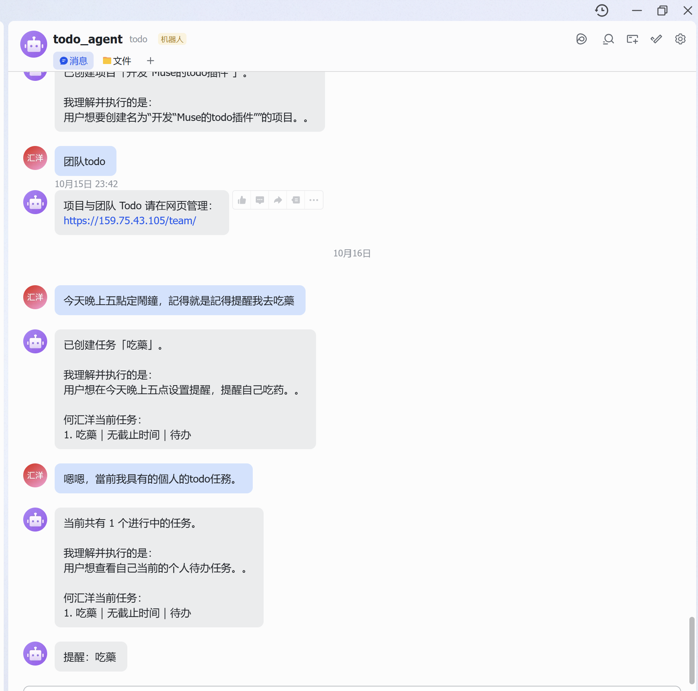</a>

### Project Todo: make team progress visible

A connected tree puts projects, tasks, subtasks, status and owners in one view. The header shows the proportion of ended tasks, while the sidebar switches projects. Break down complex work and follow its progress at each level.

This project-tree example shows six tasks and progress of 1/6 ended tasks.

<a href="docs/images/lark-project-progress.png">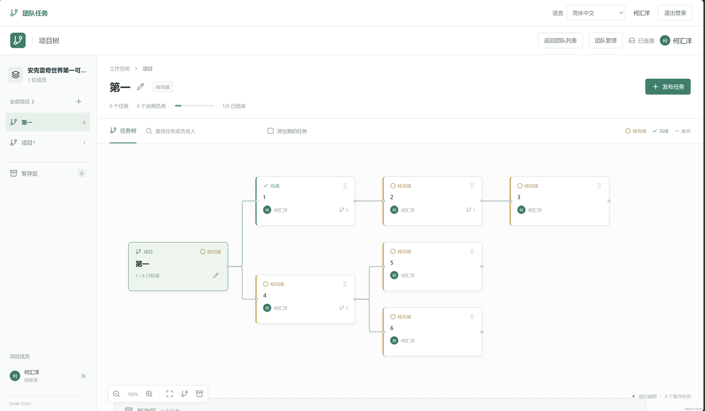</a>

## Download

**[Download the Feishu Agent installer · huiyang-setup.exe](https://github.com/there-is-a-spirit-in-the-abyss/Lark_todo-agent/releases/latest/download/huiyang-setup.exe)**

[All releases and checksums](https://github.com/there-is-a-spirit-in-the-abyss/Lark_todo-agent/releases) · [GitHub repository](https://github.com/there-is-a-spirit-in-the-abyss/Lark_todo-agent)

Double-click the download to open the deployment wizard. Your computer needs no separate Python, Node.js or SSH installation.
The repository is currently private; downloading requires an authorized GitHub account.

## Installation and deployment

**[▶ Watch the installation and deployment tutorial on Bilibili (Chinese)](https://www.bilibili.com/video/BV16nnV6ZEXo/)**

### What you need

- A Linux server reachable over SSH, with its address, port, username and password or private key.
- A Feishu group in the same organization or team, and permission to create and configure an internal app.
- The app's App ID / App Secret, plus a model endpoint, API key and model name.
- An HTTPS address for the team webpage, with deployment and certificate-validation ports open.

### Deployment order

1. Create an internal Feishu app, enable its bot and get its App ID / App Secret. Enable **all 10 application-identity permissions shown below**, configure their data scope, and publish an initial version.
2. Prepare your model settings. For DeepSeek, follow [Get a DeepSeek API key](#deepseek-api) below.
3. Open `huiyang-setup.exe` and enter SSH details, server directory, Feishu credentials, model settings and the website address. An existing `.env` can be imported.
4. Deploy and wait for successful server startup. **The installer supplies the redirect URL after you fill in the settings and successfully deploy**, in its result or deployment log.
5. Copy that complete URL into the Feishu app's **Security settings → Redirect URLs**, add it and save.
6. Once the running application has established its Feishu long connection, save long-connection event delivery and subscribe to `im.message.receive_v1`.
7. Publish the configuration changes and complete approval, add the bot to the target group, then verify personal tasks, actual reminders and the webpage opened by mentioning the bot with `team tasks`.

App creation, permission setup, event subscription, publishing, approval and redirect registration remain manual. The wizard deploys the server application.

### Create the app, obtain credentials and add its bot

<details>
<summary>Expand the three app-creation screenshots</summary>

Open the [Feishu developer console](https://open.feishu.cn/app) and create an internal app.

[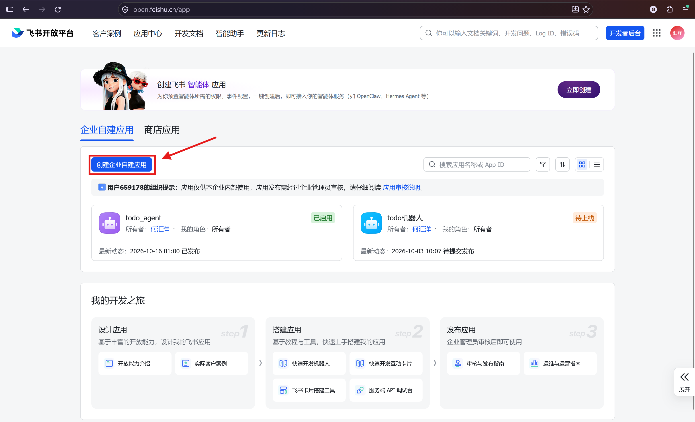](docs/images/feishu-create-app.png)

Get your own App ID and App Secret from the credentials page and enter them in the installer.

[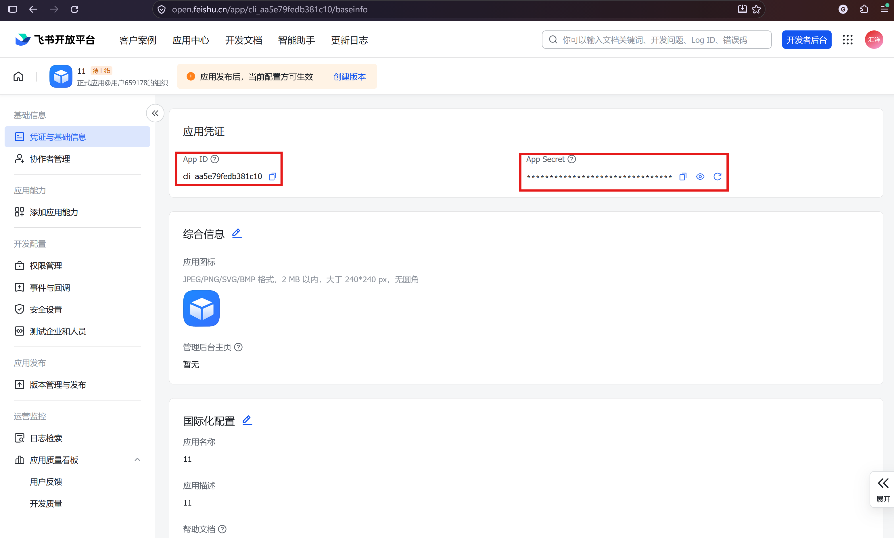](docs/images/feishu-app-credentials.png)

Add the Bot capability.

[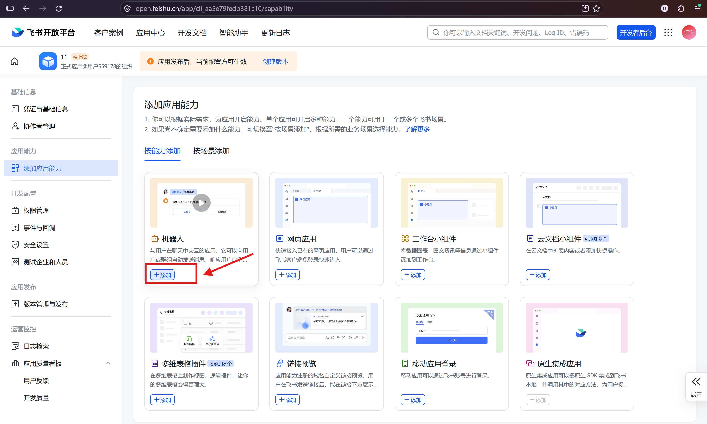](docs/images/feishu-add-bot.png)

</details>

### Permissions: enable all 10 shown in the screenshot

**Every permission listed here must show as enabled.** In Permission management, search by identifier under application-identity permissions.

| Permission | Purpose |
|---|---|
| `contact:contact.base:readonly` | Read basic directory information |
| `contact:user.base:readonly` | Read basic user information |
| `contact:user.employee_id:readonly` | Read user IDs |
| `im:chat.members:read` | Read group members |
| `im:chat:read` | Read group information |
| `im:message` | Read and send private and group messages |
| `im:message.group_msg` | Read group messages |
| `im:message.p2p_msg:readonly` | Read private messages sent to the bot |
| `im:message:send_as_bot` | Send messages as the bot |
| `im:resource` | Read and upload image or file resources |

[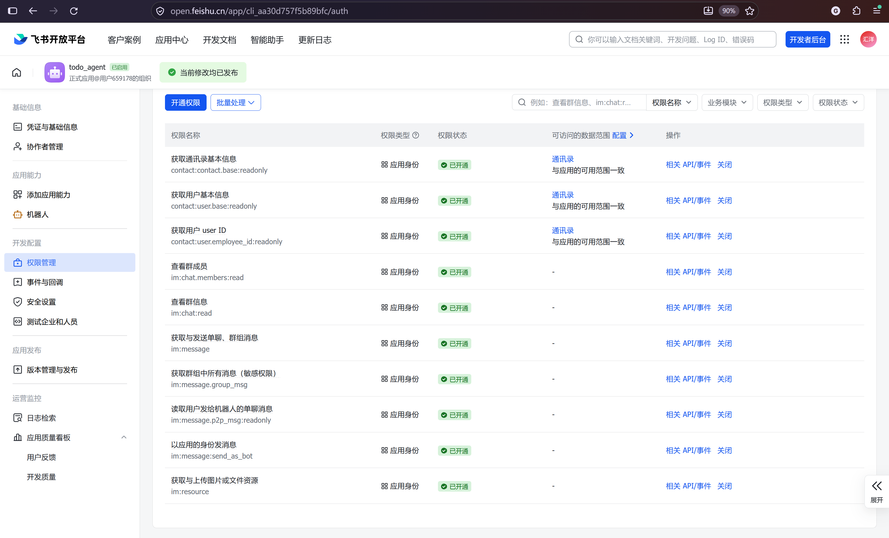](docs/images/feishu-permissions.png)

<details>
<summary>Expand permission selection and directory data scope</summary>

Select each application-identity permission. This example searches for `contact:user.base:readonly`; repeat for every permission in the table.

[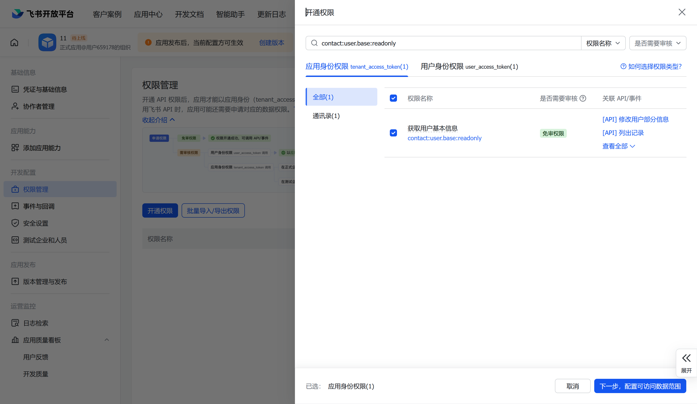](docs/images/feishu-add-permission.png)

As shown, set the directory data scope to all members and ensure app availability includes the people who will use it. Save and confirm.

[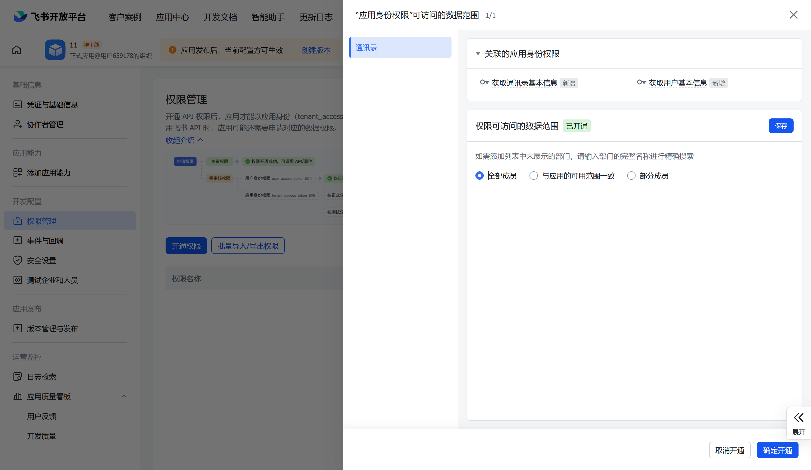](docs/images/feishu-data-scope.png)

</details>

### Redirect URL: deploy first, then copy it to Feishu

**Fill in the installer settings, deploy successfully, and then copy the redirect URL it supplies into the location below.**
The URL comes from the actual HTTPS deployment address and ends in `/api/team/callback`. Installer versions with a Feishu configuration page provide a copy button; other versions show it in the deployment log.

For a webpage at `https://tasks.example.com/team`, the redirect URL has this form:

```text
https://tasks.example.com/api/team/callback
```

Use your own installer's complete URL in **Security settings → Redirect URLs**, add it and save.

[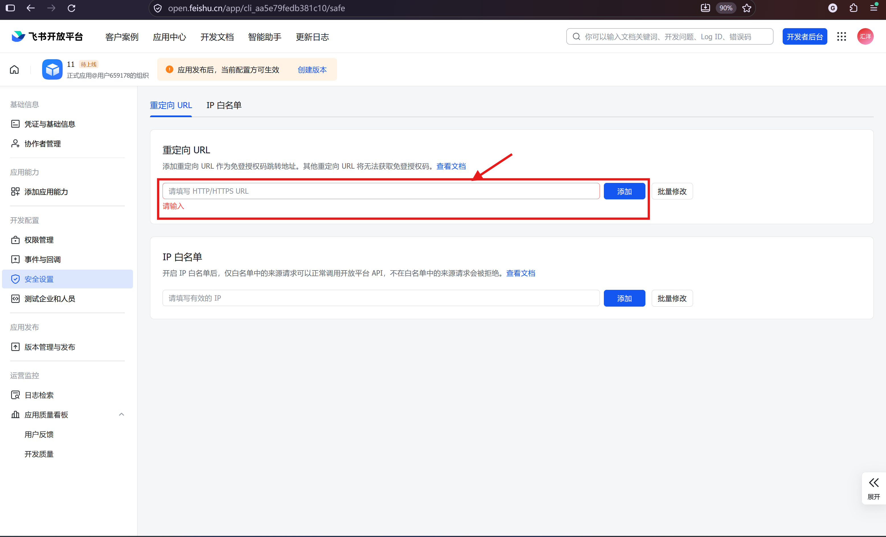](docs/images/feishu-redirect-url.png)

### Configure the long connection and message event after startup

<details>
<summary>Expand event configuration screenshots</summary>

After the server application establishes its Feishu long connection, select long-connection event delivery, verify it and save. If no connection exists yet, check deployment status and app credentials first.

[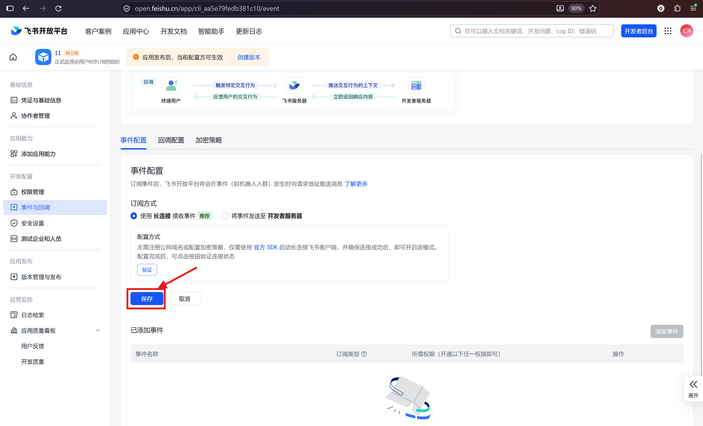](docs/images/feishu-long-connection.png)

Add the receive-message event `im.message.receive_v1`.

[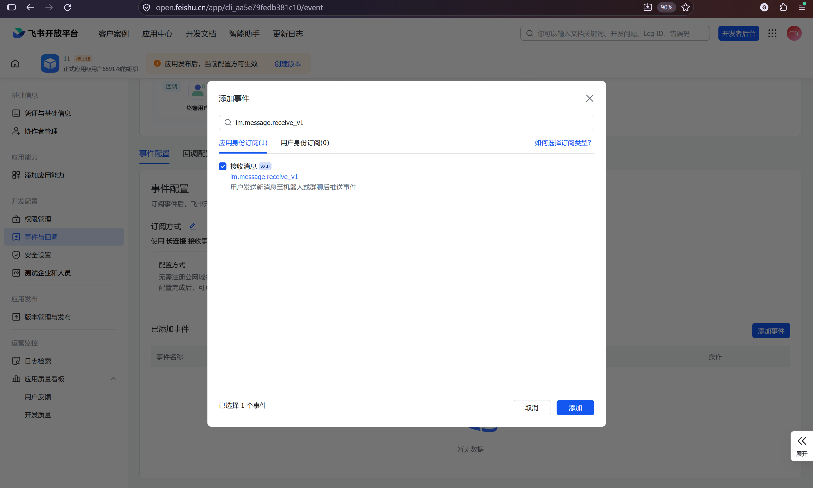](docs/images/feishu-message-event.png)

</details>

### Publish and verify

<details>
<summary>Expand app availability and successful publication</summary>

Create a version, include the actual users in its availability, save and submit for approval. The screenshot also shows external-sharing options chosen for the example account; internal collaboration can use your organization's internal availability.

[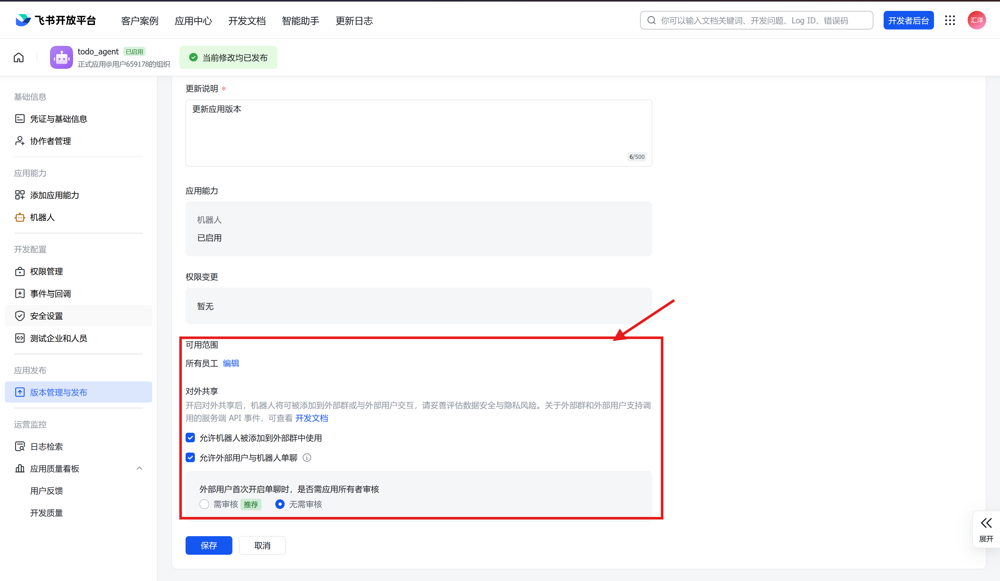](docs/images/feishu-publish-settings.png)

After the approval and publication notification, add the bot to the target group and check private todos, reminders and the team webpage.

[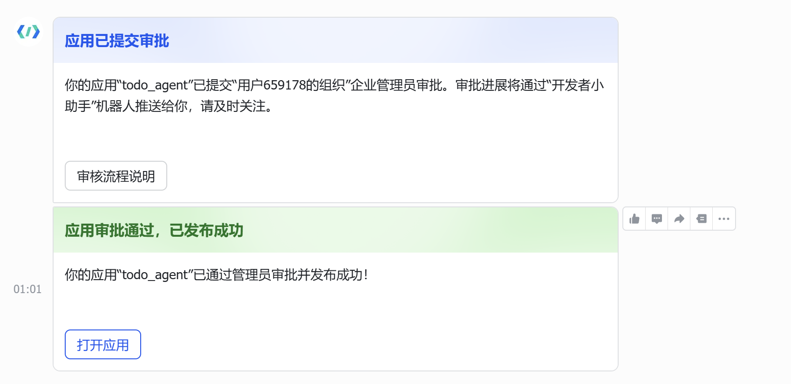](docs/images/feishu-publish-success.png)

</details>

[Installer guide](installer/README.md) · [Feishu and model setup](docs/MANUAL_SETUP.md) · [Team webpage deployment](docs/TEAM_WEB_SETUP.md)

<details>
<summary>Languages, source deployment, task rules and verification</summary>

### Languages

- Set `APP_LANGUAGE=zh-CN` (default) or `APP_LANGUAGE=en-US` in `.env`, then recreate
  the app container so it reloads configuration.
- In private chat send `/language en-US` or `/language zh-CN`. This stores a
  preference by the real Feishu user ID and applies to future private replies and
  reminders, including after restarts. An unsupported code returns command usage.
- In legacy group mode (`TEAM_WEB_ENABLED=false`), mention the actual bot and send
  the same command to change the language shared by that group. Without the bot
  mention it is not a language command.
- In team-web mode, group messages remain entry-link-only. Mention the bot with
  `team tasks` or `team todo`. Entry-link replies use
  `APP_LANGUAGE`; private language commands do not change group routing.
- The webpage language selector switches between Simplified Chinese and English.
  Chinese is the browser default. Selection persists in that browser's local
  storage, including on the login/error screen. It does not change chat preferences.
- Names, task/project titles, descriptions, IDs, stored status enum values and
  original instructions remain unchanged. Model-generated understanding and
  clarification fields receive explicit language instructions; external model
  compliance still needs live verification.

### Install and deploy

Windows users can use the [Chinese graphical installer](installer/README.md):
double-click `huiyang-setup.exe`, enter SSH connection information, browse or
create a server folder (default `/Lark_todo-agent`), import or enter Feishu/model settings,
then deploy. The executable bundles its client dependencies. GitHub Releases
use a prebuilt app image; local builds include a clean source fallback which
Docker builds automatically on the server. App credentials cannot be obtained
from a personal Feishu login; explicitly selected `.env` files can be imported.

For source development, the following commands require Python 3.11+ and Node/npm.
Docker builds now build the frontend internally; they do not need host Node/npm.
Run commands from your checkout; `<project-dir>` means where you unpacked it.

```powershell
cd <project-dir>
python -m venv .venv
.\.venv\Scripts\python.exe -m pip install ".[test]"
npm --prefix web ci
npm --prefix web run build
```

On Linux, use `.venv/bin/python` instead of the Windows Python path. Configure a
private `.env` using `.env.example`; generate a new random `POSTGRES_PASSWORD`.
Set your Feishu app credentials and HTTPS model endpoint/key/model there. Never
commit `.env`. See [Feishu setup](docs/MANUAL_SETUP.md) for app scopes and events.

```sh
docker compose config --quiet
docker compose up -d --build
```

Compose migrates the database and starts one worker plus a separate SDK receiver
process. `/root/huiyang` is the image's internal working directory; your host
checkout can use another location. Host API binding is `127.0.0.1:8000`.
`GET /health` checks the app; it does not prove Feishu subscriptions or model access.
Data stays in `postgres_data/`; do not delete this directory when upgrading.

For the group webpage, follow [team deployment](docs/TEAM_WEB_SETUP.md): configure
public HTTPS, Feishu OAuth callback, `TEAM_PUBLIC_URL`, and the explicit
`TEAM_WEB_ENABLED` flag. The webpage always uses real Feishu membership checks.
`demo/` is retained as the original reference and test fixture; it is separate
from the connected application in `web/` and has no live Feishu integration.

### Rules and boundaries

SDK events enter a durable inbox before acknowledgment. Validated model actions
run in a business transaction with pending replies; transport retries reuse the
committed result. Feishu IDs come from authenticated events/API responses, and
names never grant permissions. Do not add app replicas or Uvicorn workers without
redesigning inbox and scheduler coordination.

In legacy mode, the first target-group event binds the API-reported group owner
once as administrator. Private messages do not initialize this binding; do not
add the bot to unrelated groups before the intended group initializes it.
Ordinary members manage their assigned tasks. Personal task states cover
to do, in progress, blocked, completed, and canceled; overdue is derived.

Team-web mode has independent group-scoped boards, three task states, immutable
authors, subtree moves/deletion, shared staging, cycle rejection, derived project
completion and empty-project cleanup. Departed authors' tasks can be maintained
by current members. Existing personal and legacy team records are retained;
legacy team records/reminders/summaries are excluded from personal mode.
See [team rules](docs/team-web-integration.md).

`LLM_PROVIDER=openai_compatible` uses strict Chat Completions JSON Schema;
`LLM_PROVIDER=deepseek` uses Responses with adapter-owned wire normalization.
No model SDK or translation call is introduced into the business layer.

### Local verification

```powershell
$env:PYTHONPATH = "src"
.\.venv\Scripts\python.exe -m pytest
.\.venv\Scripts\python.exe -m pip check
npm --prefix web run test:unit
npm --prefix web run build
npm --prefix web exec -- playwright install chromium
npm --prefix web test
```

For Linux source tests use `PYTHONPATH=src .venv/bin/python -m pytest`.

PostgreSQL integration tests are opt-in and require an isolated test database;
read their environment flags before running them. Browser tests intercept the
external API and use retained fixtures; they do not verify live OAuth or Feishu.
No production deployment or live service verification is claimed for this copy.
The pinned Feishu SDK may emit existing dependency deprecation warnings.

</details>

<a id="deepseek-api"></a>

## Get a DeepSeek API key

The five supplied screenshots follow the complete workflow: sign in, check your balance or top up as needed, create a key, copy it, and enter it in the installer.

### 1. Sign in and check usage and balance

Open the [DeepSeek Platform](https://platform.deepseek.com/), sign in or register, and view your API usage and available balance.

[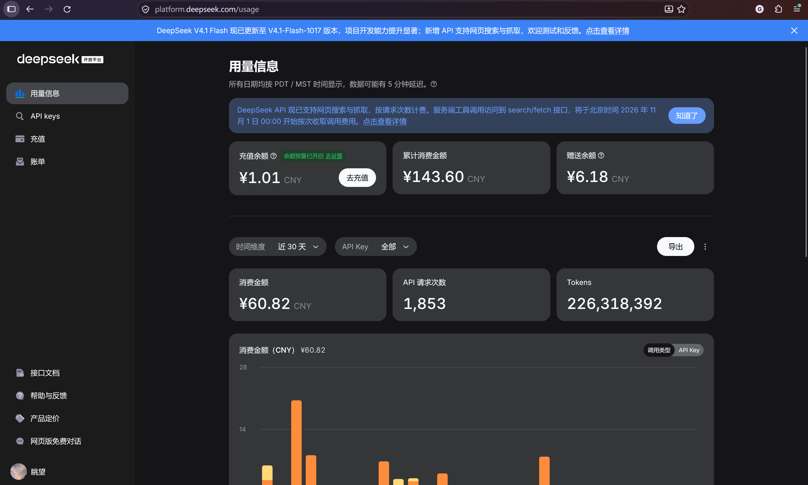](docs/images/deepseek-usage.png)

### 2. Top up if needed

Use the [top-up page](https://platform.deepseek.com/top_up) when you need additional balance. Choose the amount and payment method shown by the platform. The screenshot amount is an example, not a deployment requirement; current fees, credits and payment options are determined by the platform.

[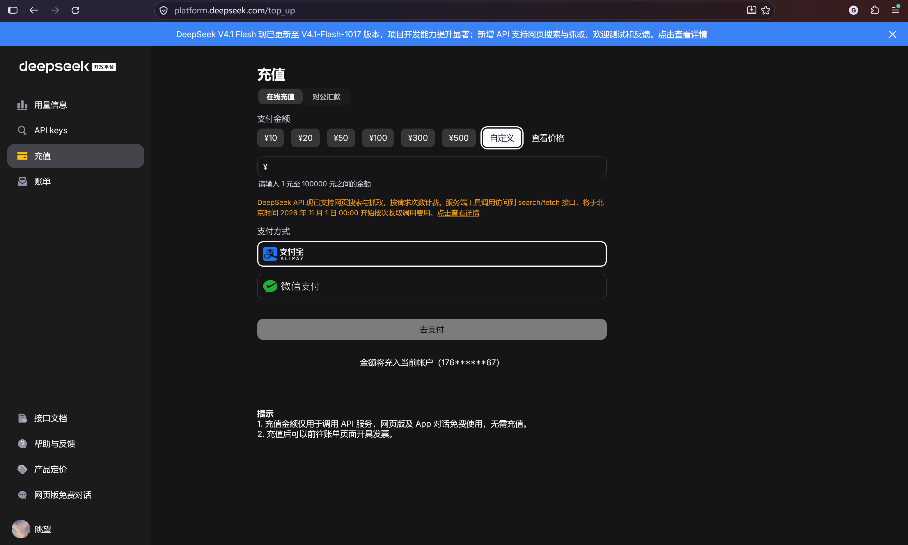](docs/images/deepseek-top-up.png)

### 3. Create an API key

Open [API keys](https://platform.deepseek.com/api_keys) and select Create API key.

[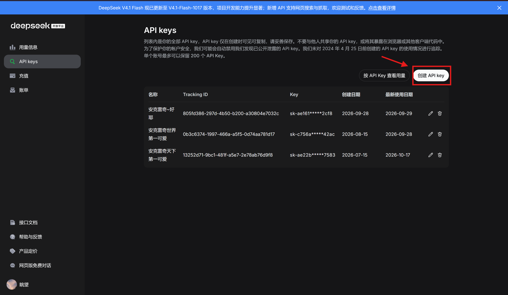](docs/images/deepseek-api-keys.png)

Give the key a recognizable name such as “Feishu Todo”, then create it.

[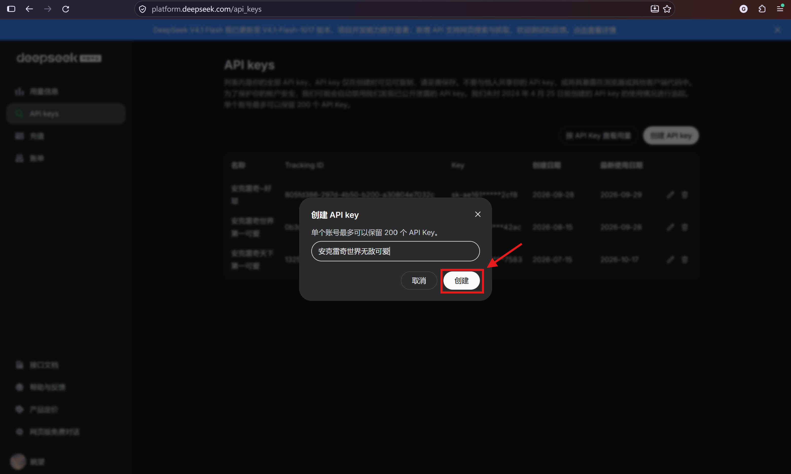](docs/images/deepseek-create-key.png)

### 4. Copy and save the full key immediately

Copy the new key, store it securely, and enter it in the installer's model API Key field. The complete key is shown only when created; create a replacement if it is lost. The supplied screenshot masks its key.

[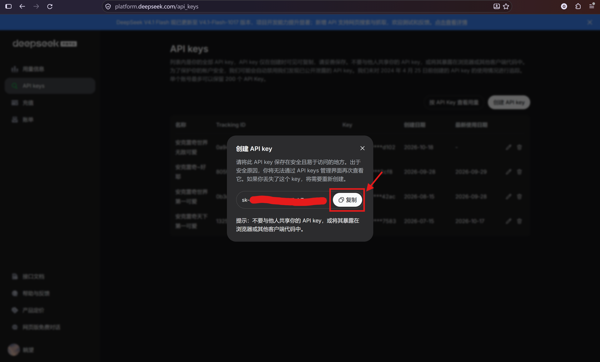](docs/images/deepseek-copy-key.png)

### 5. Enter it in the Feishu Agent installer

| Installer setting | Value |
|---|---|
| Model provider `LLM_PROVIDER` | `deepseek` |
| HTTPS API base URL `LLM_API_BASE_URL` | `https://api.deepseek.com` |
| Model API key `LLM_API_KEY` | The complete key you just created |
| Model name `LLM_MODEL` | A currently available model identifier, for example `deepseek-flash` |

This project's `deepseek` adapter uses the Responses API and appends `/responses` to the API base URL. Enter the API root above, rather than the platform website or a full `/responses` endpoint. Choose a model available to your account.

Parameter references: [official DeepSeek Responses API guide](https://api-docs.deepseek.com/guides/responses_api/) and [API reference](https://api-docs.deepseek.com/api/create-response/).
Continue with server deployment above and verify model responses, tasks and reminders through real Feishu conversations.
